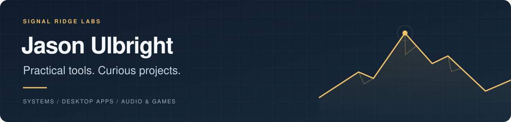

  

  <strong>Engineer. Tinkerer. Philosopher. Husband. Father.</strong>

I build and share tools I use at work and outside it: systems administration, desktop applications, development, audio and games.

  

  <a href="#for-the-day-job">IT tools</a> &nbsp;·&nbsp;
  <a href="#on-the-desktop">Desktop apps</a> &nbsp;·&nbsp;
  <a href="#after-hours">Audio &amp; games</a> &nbsp;·&nbsp;
  <a href="https://github.com/jasonulbright?tab=repositories">All repositories</a> &nbsp;·&nbsp;
  <a href="https://www.signalridgelabs.com">Signal Ridge Labs</a>

---

## For the day job

| Project | What it does |
| :--- | :--- |
| **[AppPackager](https://github.com/jasonulbright/app-packager)** | Checks vendor versions, packages applications and publishes to ConfigMgr, Intune and WSUS. |
| **[Site Hygiene](https://github.com/jasonulbright/site-hygiene)** | Scans Configuration Manager for unused objects, failed content and configuration drift, with repair tools. |
| **[Client Center](https://github.com/jasonulbright/sccmclictr)** | A maintained community fork of Client Center for Microsoft Configuration Manager. |

[AppPackager Suite](https://github.com/jasonulbright/app-packager-suite) brings together the packaging family of admin tools. There are also dedicated tools for [installer analysis](https://github.com/jasonulbright/installer-analysis), [detection testing](https://github.com/jasonulbright/detection-tester) and [building a ConfigMgr lab](https://github.com/jasonulbright/configmgr-lab-builder).

## On the desktop

| Project | What it does |
| :--- | :--- |
| **[Spectra PDF](https://github.com/jasonulbright/Spectra-PDF)** | A Windows PDF workbench with OCR, redaction, digital signatures and command-line support. |
| **[Compare All](https://github.com/jasonulbright/compare-all)** | File and folder comparison, written in Rust. |
| **[Project Dashboard](https://github.com/jasonulbright/project-dashboard)** | A Windows Git client and dashboard for the repositories in your projects folder. |

## After hours

| Project | What it does |
| :--- | :--- |
| **[WaveScope](https://github.com/jasonulbright/wavescope)** | A browser music visualizer with MilkDrop and WebGPU engines. [Try it in your browser](https://wavescope.signalridgelabs.com). |
| **[WaveScope Native](https://github.com/jasonulbright/wavescope-native)** | A native Windows visualizer with system audio capture, GPU effects, MilkDrop and recording. |
| **[pwshDoom](https://github.com/jasonulbright/pwshDoom)** | Doom in PowerShell and Windows Terminal. Bring your own Ultimate Doom WAD. |

## Support what I build

If one of these projects saves you time or gives you something fun to explore, you can [buy me a coffee](https://buymeacoffee.com/ulbright).

Support helps cover development tools, AI subscriptions, testing infrastructure and ongoing maintenance. Thank you for helping me keep building and sharing.

---

For documentation, downloads and project-specific help, start with the linked repository. Each project publishes its own license and requirements.
